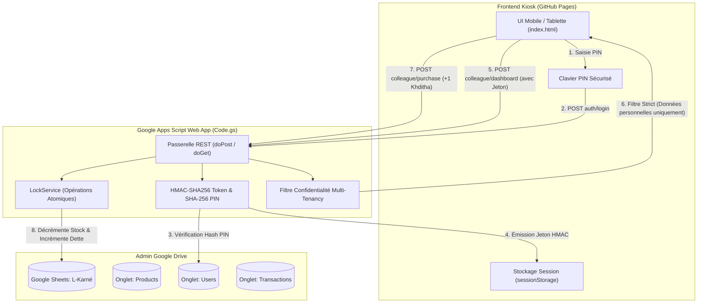

# Guide de Déploiement Complet : L-Karné 🍪

Ce guide détaille pas à pas la mise en place de votre kiosk libre-service SnackBox **"L-Karné"** hébergé gratuitement sur **GitHub Pages** et synchronisé en temps réel avec un **Google Sheet** sur le Google Drive de l'Admin via **Google Apps Script**.

---

## 🏗️ Architecture & Flux des Données



---

## 📋 Étape 1 : Création du Google Sheet & Initialisation

1. Rendez-vous sur votre compte Google Drive : [drive.google.com](https://drive.google.com)
2. Cliquez sur **Nouveau** > **Google Sheets** (Feuille de calcul vierge).
3. Renommez le document en : `L-Karné - SnackBox Bureau`.
4. Dans le menu supérieur, cliquez sur **Extensions** > **Apps Script**.
5. Un nouvel onglet d'éditeur de code s'ouvre. Renommez le projet Apps Script en `L-Karne-Backend`.

---

## 💻 Étape 2 : Configuration du Code Apps Script

1. Dans l'éditeur Apps Script, effacez tout le code contenu dans le fichier `Code.gs`.
2. Ouvrez le fichier local [`Code.gs`](file:///C:/Users/AbdelazizELMEHAMMEDY/Documents/karne/Code.gs) fourni dans ce projet, copiez l'intégralité de son contenu et collez-le dans l'éditeur Google Apps Script.
3. Cliquez sur l'icône **Enregistrer** (disquette ou `Ctrl+S`).
4. **Initialisation automatique de la base de données :**
   - Dans la barre d'outils en haut de l'éditeur Apps Script, sélectionnez la fonction `setupDatabase` dans la liste déroulante des fonctions.
   - Cliquez sur **Exécuter** (▶️).
   - Google va vous demander d'autoriser l'accès aux feuilles de calcul de votre compte. Cliquez sur **Examiner les autorisations**, choisissez votre compte Google, cliquez sur **Paramètres avancés** (en bas à gauche), puis sur **Accéder à L-Karne-Backend (non sécurisé)** et enfin **Autoriser**.
   - Dans le journal d'exécution en bas, vous verrez : `Base de données L-Karné initialisée avec succès avec les 3 onglets et les données de test !`
5. Retournez sur l'onglet de votre feuille de calcul Google Sheets : vous constaterez que les 3 onglets ont été automatiquement créés et configurés :
   - **`Products`** : pré-rempli avec les snacks marocains populaires (Sidi Ali, Merendina, Raibi Jamila, Bimo, Café, etc.).
   - **`Users`** : pré-rempli avec les comptes par défaut et leurs PINs hashés en SHA-256.
   - **`Transactions`** : tableau de suivi vierge prêt à enregistrer chaque opération.

---

## 🚀 Étape 3 : Déploiement en tant qu'Application Web

Pour que le frontend puisse communiquer avec votre backend Google Apps Script :

1. En haut à droite de l'éditeur Apps Script, cliquez sur le bouton bleu **Déployer** > **Nouveau déploiement**.
2. Cliquez sur la roue crantée à gauche de *Sélectionner un type* et choisissez **Application Web**.
3. Remplissez les paramètres **exactement** comme suit :
   - **Description** : `L-Karne Production API v1`
   - **Exécuter en tant que** : **Moi** (`votre.email@gmail.com`)
   - **Qui a accès** : **Tout le monde** (*Anyone*) — *Indispensable pour permettre aux requêtes CORS du frontend GitHub Pages d'interroger l'API sans exposer vos identifiants Google*.
4. Cliquez sur **Déployer**.
5. Copiez l'**URL de l'application Web** générée. Elle ressemble à :
   `https://script.google.com/macros/s/AKfycbx.../exec`
   *(Gardez cette URL précieusement)*.

> [!TIP]
> Si vous modifiez `Code.gs` ultérieurement, veillez à faire **Déployer** > **Gérer les déploiements** > Cliquez sur l'icône crayon > Sélectionnez **Nouvelle version** > **Déployer**.

---

## 🌐 Étape 4 : Configuration & Liaison avec le Frontend

1. Ouvrez le fichier [`index.html`](file:///C:/Users/AbdelazizELMEHAMMEDY/Documents/karne/index.html) dans votre navigateur (ou sur votre téléphone/tablette).
2. Cliquez sur l'icône **⚙️ (Paramètres)** en haut à droite (ou sur le badge *Mode Démo*).
3. Dans le champ **URL Web App**, collez votre URL Apps Script copiée à l'étape précédente.
4. Cliquez sur **Tester la connexion** : vous devriez voir un toast vert `Connexion réussie avec Google Sheets ! 🟢`.
5. Cliquez sur **Enregistrer**. Le badge en haut devient vert : `Google Sheets Connecté`.

---

## 🐙 Étape 5 : Déploiement Gratuit sur GitHub Pages

### Option A : Déploiement Standard (Recommandé, simple & direct)

1. Créez un nouveau dépôt public sur GitHub : `https://github.com/new` (nommez-le par exemple `l-karne`).
2. Dans votre terminal dans ce dossier :
   ```bash
   git remote add origin https://github.com/VOTRE_USERNAME/l-karne.git
   git branch -M main
   git push -u origin main
   ```
3. Sur GitHub, ouvrez votre dépôt et allez dans **Settings** > **Pages** (dans le menu latéral gauche).
4. Sous **Build and deployment** :
   - **Source** : `Deploy from a branch`
   - **Branch** : `main` / `/(root)`
   - Cliquez sur **Save**.
5. En moins de 60 secondes, votre kiosk sera accessible publiquement à l'adresse :
   `https://VOTRE_USERNAME.github.io/l-karne/`

---

## 🔑 Identifiants & Comptes de Démonstration Inclus

| Rôle | Nom | Identifiant | Code PIN initial | Privilèges |
| :--- | :--- | :--- | :--- | :--- |
| **Admin** | Admin Bureau | `admin` | `9999` | Vue globale, soldes de tous, restock, mark as paid |
| **Colleague** | Aziz El Mehammedy | `aziz` | `1234` | Vue personnelle, grab (+1), historique propre |
| **Colleague** | Omar Bennani | `omar` | `1234` | Vue personnelle, grab (+1), historique propre |
| **Colleague** | Salma Alami | `salma` | `1234` | Vue personnelle, grab (+1), historique propre |
| **Colleague** | Mehdi Tazi | `mehdi` | `1234` | Vue personnelle, grab (+1), historique propre |

---

## 🔒 Vérification de la Sécurité & Confidentialité

1. **Test DevTools Network :**
   - Connectez-vous avec le compte `aziz` (PIN `1234`).
   - Ouvrez l'inspecteur du navigateur (`F12` > onglet **Réseau** / **Network**).
   - Effectuez un achat ou rafraîchissez la page.
   - Inspectez la réponse de `colleague/dashboard` : vous constaterez que **seules** les données et dettes d'`aziz` sont renvoyées par le serveur. Les données d'Omar, Salma ou le total du bureau sont filtrées en amont sur Google Apps Script et ne transitent jamais sur le réseau.
2. **Test Concurrence :**
   - `LockService` garantit qu'en cas de double-clic rapide ou de 2 collègues achetant le dernier article au même moment, l'un des deux sera servi et le second recevra une alerte *Stock insuffisant*, sans corrompre le fichier Google Sheets.