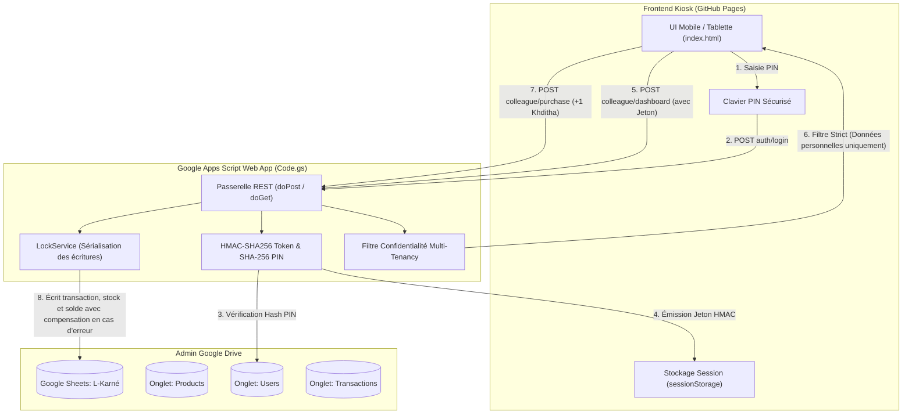

# Guide de Déploiement Complet : L-Karné 🍪

Ce guide détaille pas à pas la mise en place de votre kiosk libre-service SnackBox **"L-Karné"** hébergé gratuitement sur **GitHub Pages** et synchronisé en temps réel avec un **Google Sheet** sur le Google Drive de l'Admin via **Google Apps Script**.

---

## 🏗️ Architecture & Flux des Données



---

## 📋 Étape 1 : Création du Google Sheet & Initialisation

1. Rendez-vous sur votre compte Google Drive : [drive.google.com](https://drive.google.com)
2. Cliquez sur **Nouveau** > **Google Sheets** (Feuille de calcul vierge).
3. Renommez le document en : `L-Karné - SnackBox Bureau`.
4. Dans le menu supérieur, cliquez sur **Extensions** > **Apps Script**.
5. Un nouvel onglet d'éditeur de code s'ouvre. Renommez le projet Apps Script en `L-Karne-Backend`.

---

## 💻 Étape 2 : Configuration du Code Apps Script

1. Dans l'éditeur Apps Script, effacez tout le code contenu dans le fichier `Code.gs`.
2. Ouvrez le fichier local [`Code.gs`](./Code.gs) fourni dans ce projet, copiez l'intégralité de son contenu et collez-le dans l'éditeur Google Apps Script.
3. Cliquez sur l'icône **Enregistrer** (disquette ou `Ctrl+S`).
4. **Initialisation automatique de la base de données :**
   - Dans la barre d'outils en haut de l'éditeur Apps Script, sélectionnez la fonction `setupDatabase` dans la liste déroulante des fonctions.
   - Cliquez sur **Exécuter** (▶️).
   - Google va vous demander d'autoriser l'accès aux feuilles de calcul de votre compte. Cliquez sur **Examiner les autorisations**, choisissez votre compte Google, cliquez sur **Paramètres avancés** (en bas à gauche), puis sur **Accéder à L-Karne-Backend (non sécurisé)** et enfin **Autoriser**.
   - Dans le journal d'exécution, vous verrez un message de réussite et le PIN initial de l’admin. Notez-le immédiatement et gardez-le privé; il n’est pas affiché dans l’application ni envoyé aux clients.
5. Retournez sur l'onglet de votre feuille de calcul Google Sheets : vous constaterez que les onglets ont été automatiquement créés et configurés :
   - **`Products`** : pré-rempli avec les 65 produits et prix du deuxième onglet de `Selma-7anota.xlsx`. Le stock initial est à zéro, car le classeur ne contient pas les quantités.
   - **`Users`** : contient les 36 clients du premier onglet avec leur solde. Solde positif = dette du client; solde négatif = avance/crédit; cellule vide = zéro. Les identifiants et PINs restent vides tant que le client n’active pas son compte.
   - **`Invites`** : contient un code privé à usage unique par client. Copiez chaque code et transmettez-le uniquement à son propriétaire. Ne partagez jamais cette feuille ni le Google Sheet.
   - **`Transactions`** : tableau de suivi vierge prêt à enregistrer chaque opération.
   - **`Settings`** : conserve le dernier montant de caisse que vous avez compté.

Si vous avez déjà initialisé une feuille avec les données de test, vérifiez qu’elle ne contient que des données à supprimer, puis sélectionnez et exécutez **`replaceDemoDataWithWorkbook`** dans Apps Script. Cette opération efface les anciens produits, comptes, transactions, paramètres de caisse et codes d’invitation avant de charger les données du classeur et de générer un nouveau PIN admin. Elle invalide également les sessions déjà ouvertes. Elle est volontairement manuelle et destructive. Pour conserver les données existantes, n’exécutez pas cette fonction.

Pour conserver les données d’une base déjà en service tout en appliquant la normalisation du catalogue café, exécutez **`setupDatabase`** dans Apps Script. Cette opération ne supprime ni les comptes, ni les soldes, ni les transactions; elle renomme Coffee L'OR en `Capsule L'or` et laisse active une seule variante de café (celle avec le stock positif le plus élevé, ou la variante L'OR si aucune n’a de stock). Les autres variantes restent dans la feuille, désactivées pour l’application.

La récupération du PIN ajoute automatiquement les colonnes `pin_reset_required`, `pin_reset_requested_at` et `session_version` à l’onglet `Users` lors de l’initialisation ou du premier accès. Un client demande le reset depuis l’écran de connexion; l’administrateur vérifie son identité en personne puis lui remet directement le PIN temporaire affiché une seule fois. Le client doit créer son nouveau PIN avant que les autres fonctions deviennent accessibles.

---

## 🚀 Étape 3 : Déploiement en tant qu'Application Web

Pour que le frontend puisse communiquer avec votre backend Google Apps Script :

1. En haut à droite de l'éditeur Apps Script, cliquez sur le bouton bleu **Déployer** > **Nouveau déploiement**.
2. Cliquez sur la roue crantée à gauche de *Sélectionner un type* et choisissez **Application Web**.
3. Remplissez les paramètres **exactement** comme suit :
   - **Description** : `L-Karne Production API v1`
   - **Exécuter en tant que** : **Moi** (`votre.email@gmail.com`)
   - **Qui a accès** : **Tout le monde** (*Anyone*) — *Indispensable pour permettre aux requêtes CORS du frontend GitHub Pages d'interroger l'API sans exposer vos identifiants Google*.
4. Cliquez sur **Déployer**.
5. Copiez l'**URL de l'application Web** générée. Elle ressemble à :
   `https://script.google.com/macros/s/AKfycbx.../exec`
   *(Gardez cette URL précieusement)*.

> [!TIP]
> Si vous modifiez `Code.gs` ultérieurement, veillez à faire **Déployer** > **Gérer les déploiements** > Cliquez sur l'icône crayon > Sélectionnez **Nouvelle version** > **Déployer**. Les changements de `index.html` doivent également être publiés sur GitHub Pages.

> [!IMPORTANT]
> Pour un achat, l’application écrit d’abord une ligne `PENDING` dans `Transactions`, puis met à jour le stock et, si nécessaire, le solde du client. La transaction devient `COMPLETE` seulement après vérification; seules les lignes `COMPLETE` sont affichées dans l’historique et comptabilisées dans la caisse. En cas d’échec, les changements sont annulés autant que possible et la ligne passe à `FAILED`. Google Sheets ne prend pas en charge une transaction atomique entre plusieurs onglets; si l’application indique que l’annulation n’a pas pu être vérifiée, ne réessayez pas avant que l’administrateur ait vérifié `Products`, `Users` et `Transactions`. Les anciennes lignes sans état restent considérées comme terminées.

> [!NOTE]
> Les colonnes `status`, `cancel_status`, `cancel_requested_at`, `cancel_decided_at` et `cancel_decided_by` sont créées automatiquement par le nouveau code si elles n’existent pas. Après avoir remplacé le code dans Apps Script et publié une nouvelle version du déploiement, publiez également le frontend mis à jour sur GitHub Pages.

> [!IMPORTANT]
> Le client peut demander l’annulation d’un achat depuis son historique. L’administrateur traite la demande dans **Activité récente** avec **Approuver** ou **Refuser**; il peut également annuler directement un achat terminé. L’approbation rétablit le stock et corrige le solde dû. Pour un achat payé, l’administrateur doit d’abord récupérer l’article et rembourser l’argent en espèces : l’application enregistre alors le remboursement et le déduit de la caisse. Chaque annulation approuvée est conservée comme une nouvelle ligne d’audit dans `Transactions`.

---

## 🌐 Étape 4 : Configuration & Liaison avec le Frontend

1. Ouvrez le fichier [`index.html`](./index.html) dans votre navigateur (ou sur votre téléphone/tablette).
2. Cliquez sur l'icône **⚙️ (Paramètres)** en haut à droite (ou sur le badge *Backend non configuré*).
3. Dans le champ **URL Web App**, collez votre URL Apps Script copiée à l'étape précédente.
4. Cliquez sur **Tester la connexion** : vous devriez voir un toast vert `Connexion réussie avec Google Sheets ! 🟢`.
5. Cliquez sur **Enregistrer**. Le badge en haut devient vert : `Google Sheets Connecté`.
6. Répétez cette configuration sur chaque appareil. Connectez-vous avec `admin` et le PIN initial noté dans le journal d’exécution. Ouvrez le tableau de bord pour saisir le montant réellement compté dans la caisse; après un nouveau comptage, saisissez-le à nouveau.
7. Remettez à chaque client uniquement son code privé. Il crée son identifiant et son PIN depuis **Créer un compte**; l’inscription active sa fiche importée et conserve automatiquement son solde. Un code est utilisable une seule fois.
8. Pour obtenir la liste des codes avec les noms correspondants, connectez-vous comme admin et cliquez sur **Exporter les codes**. Le CSV ne contient que les invitations non utilisées; gardez-le privé et remettez chaque code uniquement à son propriétaire.
9. Dans l’onglet admin **Gestion du stock**, cliquez **Achat** pour ajouter un produit nouvellement acheté : saisissez la quantité reçue et le coût total payé (pas le coût unitaire), puis enregistrez. Le stock augmente, la dépense apparaît dans l’activité et son montant est déduit de la **Caisse enregistrée** depuis le dernier comptage. Si vous refaites un comptage réel de la caisse, ce nouveau comptage devient la base des calculs suivants.
10. Lors de la création d’un nouveau produit, saisissez également le **Coût total payé (DH)** si son stock initial vient d’être acheté. Le produit est créé, son stock initial est ajouté et le coût est enregistré/déduit de la caisse. Laissez le coût vide si vous saisissez du stock déjà présent ou repris lors du démarrage de l’application.
11. Le bouton **Retirer** sert uniquement à corriger le stock à la baisse; saisissez le nombre d’unités à retirer dans la fenêtre de confirmation. Cette correction ne comptabilise pas de dépense et le stock ne peut pas devenir négatif.
12. Le stock de `Tea (3pc)` et `Trident (3pc)` est saisi en pièces physiques. Lorsqu’un client prend une portion, le prix affiché est facturé une fois et trois pièces sont retirées; le catalogue indique le nombre de portions complètes disponibles. Saisissez également en pièces physiques toute quantité ajoutée par **Achat**.
13. Pour régler une dette, saisissez un montant positif; pour annuler un paiement saisi en trop, saisissez un montant négatif. La correction ajuste le solde du client et la caisse.
14. Pour corriger un produit, cliquez sur l’icône crayon dans sa ligne d’inventaire. La fenêtre affiche son nom, son prix de vente et sa catégorie actuels; vous pouvez modifier le nom et le prix, choisir une catégorie existante ou sélectionner **+ Ajouter une catégorie…** pour en saisir une nouvelle. Cliquez **Enregistrer** pour sauvegarder. Le changement n’affecte ni le stock ni les transactions déjà enregistrées.
15. Pour un produit existant, ouvrez **Chercher** dans sa ligne d’inventaire, choisissez une photo autorisée du bon emballage, copiez son adresse directe HTTPS (pas l’adresse de la page de résultats), collez-la dans le champ URL puis cliquez **Image**. La même adresse peut être saisie lors de la création d’un produit. L’application stocke uniquement le lien dans `Products.image_url`; elle ne téléverse pas les fichiers. Jusqu’à ce que des URLs de photos soient enregistrées, les produits existants continuent d’afficher leurs emojis.

---

## 🐙 Étape 5 : Déploiement Gratuit sur GitHub Pages

### Option A : Déploiement Standard (Recommandé, simple & direct)

1. Créez un nouveau dépôt public sur GitHub : `https://github.com/new` (nommez-le par exemple `l-karne`).
2. Dans votre terminal dans ce dossier :
   ```bash
   git remote add origin https://github.com/VOTRE_USERNAME/l-karne.git
   git branch -M main
   git push -u origin main
   ```
3. Sur GitHub, ouvrez votre dépôt et allez dans **Settings** > **Pages** (dans le menu latéral gauche).
4. Sous **Build and deployment** :
   - **Source** : `Deploy from a branch`
   - **Branch** : `main` / `/(root)`
   - Cliquez sur **Save**.
5. En moins de 60 secondes, votre kiosk sera accessible publiquement à l'adresse :
   `https://VOTRE_USERNAME.github.io/l-karne/`

---

## 🌐 Utilisation depuis les deux étages et à distance

Utilisez l'URL GitHub Pages depuis chaque appareil et configurez une seule fois la même URL Apps Script `/exec`. Les opérations vont directement vers le même Google Sheet, donc les différents réseaux Wi-Fi et le télétravail ne posent pas de problème tant que l'appareil a Internet. Aucun ordinateur du bureau ne doit rester allumé comme serveur.

Les opérations sont partagées dès leur enregistrement, mais une page déjà ouverte ne reçoit pas de notification automatique pour les changements des autres utilisateurs ; actualisez la vue pour les consulter. En cas de coupure Internet, les ventes ne sont pas synchronisées : attendez le retour de la connexion avant de saisir les opérations. Aucun compte ou produit de démonstration local n’est fourni.

La caisse indiquée correspond au dernier montant compté + les ventes payées immédiatement + les règlements de dettes reçus depuis ce comptage. Un nouveau comptage remplace la base précédente et évite de compter deux fois les encaissements antérieurs. Le réapprovisionnement n'est pas déduit : cette valeur suit les encaissements, pas le bénéfice net.

---

## 🔑 Comptes & Codes d’Invitation

Le PIN admin est généré lors de l’initialisation et apparaît uniquement dans le journal d’exécution Apps Script. Gardez-le privé. Les clients n’ont pas de PIN par défaut : chacun reçoit son propre code à usage unique de l’onglet `Invites`, puis choisit son identifiant et son PIN. La liste publique de connexion n’affiche que les comptes déjà activés.

---

## 🔒 Vérification de la Sécurité & Confidentialité

1. **Test DevTools Network :**
   - Créez un compte client avec un code d’invitation et connectez-vous avec le PIN choisi.
   - Ouvrez l'inspecteur du navigateur (`F12` > onglet **Réseau** / **Network**).
   - Effectuez un achat ou rafraîchissez la page.
   - Inspectez la réponse de `colleague/dashboard` : vous constaterez que **seules** les données et la dette du compte connecté sont renvoyées par le serveur. Les soldes des autres clients et le total du bureau sont filtrés en amont sur Google Apps Script et ne transitent jamais sur le réseau.
2. **Test Concurrence :**
   - `LockService` garantit qu'en cas de double-clic rapide ou de 2 collègues achetant le dernier article au même moment, l'un des deux sera servi et le second recevra une alerte *Stock insuffisant*, sans corrompre le fichier Google Sheets.